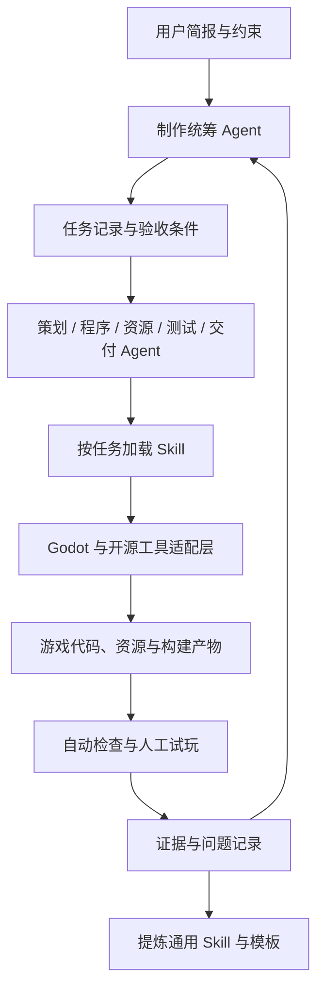

# FAgent 体系设计

## 目标与边界

服务对象是希望独立或小团队制作游戏的用户。最终交付包含游戏样例、开发角色定义、可安装 Skill、经过验证的模板，以及从简报到构建的操作说明。

本轮只设计通用体系。游戏题材、2D/3D、玩法、目标平台和美术风格留待立项；通用能力应能迁移，具体玩法通过后续模板包承载。首版不把联网服务、运营、社区客服或自主发布纳入必要范围。

“快速制作”应体现为较少的手工步骤、更短的首次可玩时间，以及较高的任务验收通过率；不能仅用生成文件数量衡量。

## 架构



首版用 Markdown、YAML 和脚本完成协作即可。先由单个会话依次扮演不同角色；需要并行时再由宿主提供调度，并让不同任务使用独立分支或工作区。无需先开发分布式 Agent 平台或向量数据库。

### 三类可复用对象

| 对象 | 负责什么 | 不应承载什么 |
| --- | --- | --- |
| Agent | 接收目标、选择 Skill、对角色交付负责 | 重复复制所有工具操作步骤 |
| Skill | 完成某类任务的方法、输入输出、辅助脚本与验证 | 绑定某个游戏的角色名和剧情 |
| 模板 | 可运行场景、资源结构、玩法示例、默认参数 | 代替任务验收与工程验证 |

角色用普通 Markdown 定义，便于移植。Codex 等宿主可增加专用适配；这些适配的格式不应成为核心工作流的唯一入口。使用 `.codex/skills/` 等发现路径时，应在适配说明中明确宿主与版本前提，不假设所有工具支持相同格式。

## Agent 分工

以下均为拟建角色，尚未实现。角色数量不等于同时启动的进程数量；一个小任务可由同一会话完成。

| 角色 | 核心责任 | 主要输入 | 交付物与完成依据 |
| --- | --- | --- | --- |
| 制作统筹 `producer` | 控制范围、拆分依赖、安排集成 | 用户目标、进度、风险 | 简报、任务列表、验收条件；每项任务有负责人 |
| 游戏策划 `designer` | 把体验目标转成可实现规则 | 简报、试玩反馈 | 核心循环、规则、参数、关卡需求；程序可据此实现 |
| Godot 程序 `godot-engineer` | 场景、脚本、UI、数据与编辑器工具 | 已验收需求、工程上下文 | 可运行增量；提交复现步骤及检查结果 |
| 资源制作 `asset-creator` | 美术、动画、音效与导入规范 | 资源需求、风格约束、目标平台 | 源文件、游戏资源、来源记录；在 Godot 中验证导入 |
| 质量验证 `qa` | 功能、回归、性能与试玩记录 | 任务验收条件、构建 | 测试证据、缺陷复现、未覆盖范围 |
| 构建交付 `release` | 导出、打包、说明与第三方清单 | 已通过检查的工程、目标平台 | 可启动构建、构建记录、归属说明 |

首个闭环先实现统筹、程序、质量验证三个角色。策划、资源和交付角色随实际需求加入；音频或数值工作量增大时，再从现有职责拆分专职角色。

## Skill 目录

按可验收任务划分，避免每个按钮或工具都拆成一个 Skill。以下名称是设计候选，均未安装。

| Skill | 触发任务 | 主要产物 | 验证方式 | 时机 |
| --- | --- | --- | --- | --- |
| `game-brief` | 把游戏想法收敛成开发范围 | 简报、核心循环、任务验收条件 | 缺失决策显式列出，需求可映射到验收 | 首个闭环 |
| `godot-bootstrap` | 新建或接入标准版 Godot 项目 | 环境报告、主场景、最小工程 | 引擎与项目导入检查、启动检查 | 首个闭环 |
| `godot-feature` | 实现一项玩法或 UI 功能 | 场景、GDScript、配置增量 | 针对该功能的自动检查与试玩 | 首个闭环 |
| `godot-verify` | 验证改动或定位缺陷 | 日志、复现步骤、结论 | 区分解析、运行、交互和性能证据 | 首个闭环 |
| `game-art-pipeline` | 制作并接入 2D/3D 资源 | 源文件、导出文件、导入参数 | 尺寸、比例、动画、材质与来源检查 | 资源阶段 |
| `game-audio-pipeline` | 制作并接入音乐与音效 | 音频、总线配置、循环点 | 播放、削波、循环、音量与来源检查 | 资源阶段 |
| `godot-level-design` | 构建可游玩的场景与关卡 | 关卡、碰撞、导航或 TileMap 资源 | 可达性、出生点、流程与试玩 | 内容阶段 |
| `game-balance` | 调整规则与数值 | 参数表、模拟脚本、对比记录 | 可重现模拟和游戏内反馈相互校验 | 内容阶段 |
| `godot-localization` | 接入翻译与多语言 UI | 翻译资源、语言切换、界面调整 | 字体覆盖、文本溢出与语言切换 | 交付阶段 |
| `godot-release` | 生成指定平台的可交付构建 | 导出包、版本信息、归属清单 | 独立启动检查及平台相关人工检查 | 交付阶段 |

Skill 的通用约定：

- `SKILL.md` 写明适用任务、所需输入、执行流程和完成标准；用 frontmatter 的 `name`、`description` 支持准确发现。
- 可重复且容易出错的操作封装到 `scripts/`；较长的专项说明放入 `references/`；确实需要复制的模板放入 `assets/`。
- 用户输入、项目路径、引擎路径和输出位置可配置。失败时返回已完成内容、阻塞原因及可重试条件。
- 所需工具缺失时报告缺失项。图形工具可提供人工操作路径；自动化范围以实际接口能力为准。
- 每个成熟 Skill 至少有一个真实任务记录，以及一次在另一工程或独立工作区中的复用记录。

## 任务交接协议

首版建议每项任务一个 Markdown 文件，带 YAML frontmatter。正文记录上下文、操作、证据和交接信息。以下仅为协议示例，并非当前执行中的任务：

```yaml
id: TASK-001
title: 建立可启动的空白主场景
status: ready
owner: godot-engineer
depends_on: []
project_path: godot/f-game
skills: [godot-bootstrap, godot-verify]
allowed_paths: [godot/f-game, artifacts/TASK-001]
acceptance:
  - 项目已指定主场景
  - 场景导入及启动无脚本错误
  - 图形界面中可看到约定的初始画面
```

状态约定：`planned → ready → running → review → done`；依赖或工具不可用时进入 `blocked` 并记录原因。未通过验收的任务退回 `running`。状态只是项目记录，不等同于宿主提供的 Agent 生命周期 API。

执行者交付改动文件列表、实现说明、检查命令及退出码、日志位置、截图或试玩记录、已知限制。QA 根据原有验收条件给出结论；缺少图形验证时，不得把“无窗口启动通过”写成“游戏可玩性通过”。最终由集成负责人决定合入。

### 并行与集成

- 同一任务只有一个执行负责人；共享场景、`project.godot`、输入映射和 Autoload 由集成负责人协调。
- 并行任务使用不同分支或工作区，尽量分配不同场景或模块。`.tscn` 与 `.tres` 冲突应在理解资源引用后处理，再重新导入。
- 对已完成任务检查依赖影响，避免只验证各自分支而遗漏集成失败。
- 记录任务所需的外部动作。上传、发布、购买或联系第三方的权限由用户授权范围决定，角色定义本身不授予权限。

## 建议目录

以下是后续实施的目标结构；本轮仅更新 README 与 `docs/`，不会创建空的角色或 Skill 占位文件。

```text
FAgent/
├── README.md
├── docs/                    # 设计、工具选择与路线
├── agents/                  # 可移植的角色定义
├── skills/<skill-name>/     # SKILL.md 与实际需要的辅助资源
├── adapters/                # 按需增加的 Agent 宿主适配
├── templates/               # 从已验证项目提炼的起步模板
├── tasks/                   # 简报、任务状态与验收记录
├── scripts/                 # 环境检查、验证与打包入口
├── godot/f-game/            # 当前实验工程
└── artifacts/               # 本地日志、截图、构建；实现时配置忽略规则
```

项目内维护 `skills/` 便于版本控制与分发；到实现阶段提供复制或链接到所选宿主发现目录的方法，并验证该宿主确实可加载。无需在规划阶段修改用户全局配置。

## 从游戏经验到可复用能力

按“完成真实任务 → 留存步骤和失败证据 → 区分游戏专属与通用部分 → 编写 Skill → 在另一工程复用 → 发布”的顺序推进。

通用检查、导入和构建方法进入 Skill；角色名、敌人行为、剧情和关卡内容留在游戏项目；一类玩法稳定后再提炼模板。每项能力记录适用 Godot 版本、平台、依赖与验证日期，避免宣称未经测试的兼容性。
